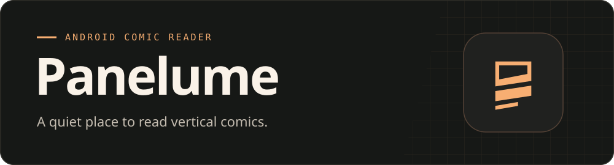

<p align="center">
  
</p>

<h1 align="center">Panelume</h1>

<p align="center">
  <strong>Scroll through a chapter. Come back to the exact panel.</strong><br>
  Android 8.0+ · Java · English and Russian UI
</p>

<p align="center">
  <a href="#get-started">Get started</a> ·
  <a href="#online-catalogues">Online catalogues</a> ·
  <a href="#build-from-source">Build from source</a> ·
  <a href="https://github.com/Lephiziel/panelume/issues/1">Reader feedback</a>
</p>

## Reading in Panelume

| Feature | What you get |
| :-- | :-- |
| **Continuous scroll** | Panels join into a single vertical strip. Tap the page to hide the controls. |
| **Pick up where you left off** | Chapter bookmarks remember the page and offset. The home screen puts your latest chapter one tap away. |
| **Take a series offline** | Save individual chapters or queue a series. See progress, retry failed downloads or cancel from Downloads. Series posters stay visible offline once loaded. |
| **Bring your own files** | Open PDF, CBZ or ZIP image archives from your device or a direct HTTPS link. |
| **Track reading time** | See totals by day and chapter. The timer runs while the reader is visible, the app has focus and the device is awake and unlocked. |

## Get started

1. Install the APK on Android 8.0 or newer. English is selected by default. You can switch to Russian in Settings.
2. Open **Search**, enter a title and choose a source. Tap a chapter to open it, or use **Download all** to queue the series.
3. To read a file you already have, open **Library → +** and select it.

**Upgrading from 0.2.2:** The distributed APK keeps the same Android application ID and signing key. It appears as **Panelume** after installation. Version 0.2.1 has its own library and can coexist with it.

## Online catalogues

| Source | Available content |
| :-- | :-- |
| **WEBTOON** | English catalogue and publicly readable episodes. Episodes that require unlocking open at the source. |
| **Weeb Central** | English catalogue and public chapter lists. |
| **MangaRead** | English catalogue and public chapter images. |
| **MangaDex** | Korean series with English chapters, with source and translation-group credits. |

Try **Viral Hit** or **How to Fight** to compare listings across sources. Chapter availability depends on the source.

## Feedback and contributions

- Share your experience in the [reader feedback thread](https://github.com/Lephiziel/panelume/issues/1). English and Russian are welcome.
- Use the [issue picker](https://github.com/Lephiziel/panelume/issues/new/choose) for bug reports and feature requests. For a bug, include your app version, Android version and steps to reproduce.
- See [what changed](CHANGELOG.md) between versions.

## Build from source

Use **JDK 17**, **Android SDK Platform 35** and **Gradle 8.9**. Open the project in Android Studio or run:

```sh
gradle assembleDebug
```

For a standalone Linux build, also install Android Build Tools 35.0.0 and `zip`, then set `ANDROID_SDK_ROOT`:

```sh
./tools/build-apk.sh
adb install -r out/Panelume-0.2.3.apk
```

To update an existing installation, sign with its original key. The standalone script accepts a keystore path through `PANELUME_DEBUG_KEYSTORE`.

## Credits

The WEBTOON adapter ports episode discovery and page extraction from [Zehina’s Webtoon-Downloader](https://github.com/Zehina/Webtoon-Downloader). See its [MIT notice](app/src/main/assets/third-party/webtoon-downloader-MIT.txt).
