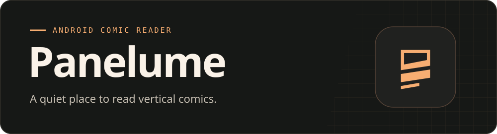

  

<h1 align="center">Panelume</h1>

  <strong>Манхва, манга, маньхуа, вебтуны и другие комиксы на Android.</strong> 
  Без рекламы в приложении · Android 8.0+

  <a href="https://github.com/Lephiziel/panelume/releases/download/v0.2.3/Panelume-0.2.3.apk"><strong>Скачать APK 0.2.3</strong></a> ·
  <a href="../README.md">English</a> ·
  <a href="../ROADMAP.md">План развития</a>

## Как начать читать

1. Скачай APK на телефон и открой файл. Если Android спросит, разреши установку через браузер или файловый менеджер, которым открыл файл.
2. Открой **Panelume** и выбери язык. Через **Поиск** найди тайтл, выбери каталог и открой главу.
3. Чтобы читать без интернета, скачай главу заранее. Свои PDF, CBZ и ZIP можно добавить через **Библиотека → +**.

Если у тебя стоит **Panelume Next 0.2.2**, установи APK поверх него, чтобы сохранить библиотеку и прогресс. У версии 0.2.1 отдельная библиотека.

## Что умеет Panelume

- Главы прокручиваются сплошной вертикальной лентой. Тап по экрану скрывает кнопки.
- Закладка запоминает место в главе. Вернуться можно через карточку продолжения на главной.
- Главы и серии можно сохранить офлайн. Статистика чтения доступна по главам и дням.

Panelume сам не показывает рекламу. На внешних сайтах могут действовать свои правила доступа к эпизодам.

[Все релизы](https://github.com/Lephiziel/panelume/releases) · [Оставить отзыв](https://github.com/Lephiziel/panelume/issues/1) · [Сообщить об ошибке](https://github.com/Lephiziel/panelume/issues/new/choose)
